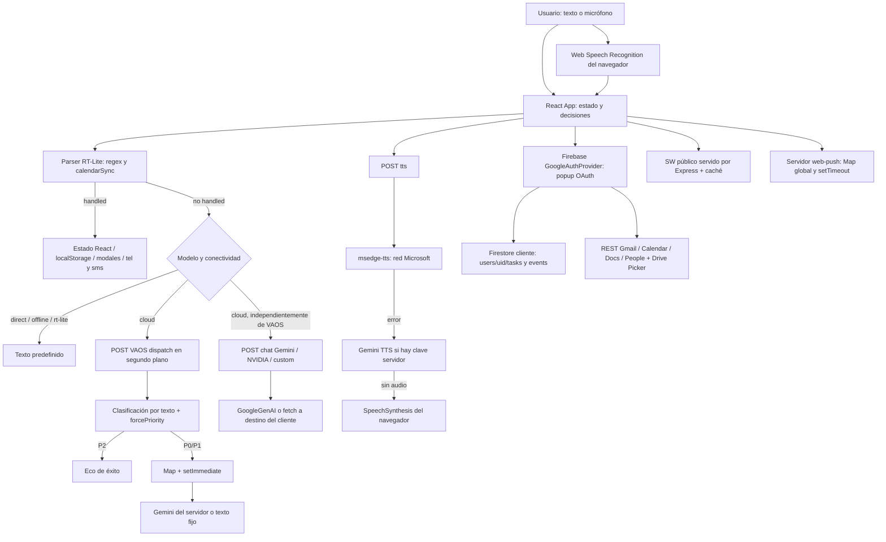

# Arquitectura encontrada e inventario

> Auditoría independiente · 2026-10-23 UTC · `main@2ffadf44c2c09bbc8dcde47046ee7d5c08a039f7` · rama `audit/codex-deep-review`. Evidencia del código fijada a ese SHA; no se cambió código funcional.

## Estructura y responsabilidad real

| Ruta | Función observada |
|---|---|
| `src/main.tsx`, `src/App.tsx` | Entrada React y estado central en hooks; App conecta parser, peticiones cloud, voz y modales. Sin router de frontend ni store externo. |
| `src/components/` | 25 componentes de interfaz: consola, ajustes, agentes, Google, calendario, documentos, bóveda, telemetría e instalación. Modales montados desde App. |
| `src/utils/rtLiteEngine.ts`, `calendarSync.ts` | Regex y respuestas fijas; objetos de acciones, conflictos, enlaces Calendar/Outlook. No runtime local de un LLM. |
| `src/utils/speech.ts` | Web Speech STT; fetch de TTS y reproducción Audio/Web Audio; SpeechSynthesis como fallback. |
| `src/utils/crypto.ts`, `ical.ts`, `documentPdfExporter.ts` | Web Crypto real; ICS y webhooks desde navegador; exportación jsPDF/TXT/CSV. |
| `src/services/` | Google REST, Firebase Auth/Firestore, Picker, notificaciones y secretos locales. Workspace se llama directamente desde el navegador. |
| `src/core/adapters/` | Fachada de plataforma, capacidades web y cliente HTTP VAOS. No adaptadores nativos instalados. |
| `src/server/vaosOrchestrator.ts` | Router Express, clasificador por palabras, Map de tareas, setImmediate y texto Gemini o predefinido. |
| `server.ts` | Express: proxies LLM, TTS Edge/Gemini, web-push, configuración pública y servidor estático/Vite. No DB del backend ni middleware de identidad. |
| `public/`, `index.html`, `vite.config.ts` | PWA, dos SW de origen y otro generado por Workbox, manifiestos, iconos y fallback offline. |
| `firebase-applet-config.json`, `firebase-blueprint.json`, `firestore.rules` | Configuración cliente, descripción de datos y reglas fuente. No `firebase.json` ni evidencia de despliegue de reglas. |
| `capacitor.config.ts` | Objeto tipado mediante interfaz local. Sin Capacitor como dependencia, proyectos Android/iOS, Electron o Tauri. |
| `.gmp_cache/` | Documentación previa, sin autoridad probatoria para esta auditoría. |

No hay README, workflows `.github`, Dockerfile, suite de tests, `package-lock.json`, `engines`, `.nvmrc` ni infraestructura de despliegue versionada en este árbol. Esto se basa en el inventario recursivo, no en una promesa documental.

## Diagrama de ejecución real



Evidencia de bifurcación: [src/App.tsx:714](https://github.com/the-VanCartier-Authority/VVC-LIAM-CORE/blob/2ffadf44c2c09bbc8dcde47046ee7d5c08a039f7/src/App.tsx#L714), [src/App.tsx:974](https://github.com/the-VanCartier-Authority/VVC-LIAM-CORE/blob/2ffadf44c2c09bbc8dcde47046ee7d5c08a039f7/src/App.tsx#L974), [src/App.tsx:1007](https://github.com/the-VanCartier-Authority/VVC-LIAM-CORE/blob/2ffadf44c2c09bbc8dcde47046ee7d5c08a039f7/src/App.tsx#L1007), [src/App.tsx:1042](https://github.com/the-VanCartier-Authority/VVC-LIAM-CORE/blob/2ffadf44c2c09bbc8dcde47046ee7d5c08a039f7/src/App.tsx#L1042). No hay tres motores aislados con contratos de autorización independientes: el parser se ejecuta antes de cualquier modelo; VAOS es una rama paralela y no una puerta de ejecución.

## Estado, persistencia y sincronización

- App conserva tareas, eventos, contactos, hasta 150 mensajes, agentes y preferencias en `localStorage` bajo `vvc_liam_*`. Secreto API usa `vvc_secret_*`, también texto plano. No hay separación por UID. [src/App.tsx:305](https://github.com/the-VanCartier-Authority/VVC-LIAM-CORE/blob/2ffadf44c2c09bbc8dcde47046ee7d5c08a039f7/src/App.tsx#L305), [src/App.tsx:393](https://github.com/the-VanCartier-Authority/VVC-LIAM-CORE/blob/2ffadf44c2c09bbc8dcde47046ee7d5c08a039f7/src/App.tsx#L393), [src/App.tsx:497](https://github.com/the-VanCartier-Authority/VVC-LIAM-CORE/blob/2ffadf44c2c09bbc8dcde47046ee7d5c08a039f7/src/App.tsx#L497), [src/services/secretsService.ts:116](https://github.com/the-VanCartier-Authority/VVC-LIAM-CORE/blob/2ffadf44c2c09bbc8dcde47046ee7d5c08a039f7/src/services/secretsService.ts#L116).
- Alarmas, temporizadores y bóveda están en React, sin persistencia. Las alarmas se añaden pero no se leen para dispararlas; temporizadores descuentan segundos mientras vive la página. [src/App.tsx:331](https://github.com/the-VanCartier-Authority/VVC-LIAM-CORE/blob/2ffadf44c2c09bbc8dcde47046ee7d5c08a039f7/src/App.tsx#L331), [src/App.tsx:565](https://github.com/the-VanCartier-Authority/VVC-LIAM-CORE/blob/2ffadf44c2c09bbc8dcde47046ee7d5c08a039f7/src/App.tsx#L565), [src/App.tsx:817](https://github.com/the-VanCartier-Authority/VVC-LIAM-CORE/blob/2ffadf44c2c09bbc8dcde47046ee7d5c08a039f7/src/App.tsx#L817).
- Firestore almacena perfil, subconjunto de campos de tareas/eventos. La UI sólo incorpora IDs nuevos desde snapshots: no actualiza ni elimina registros ya presentes. Snapshots vacíos se ignoran. Las órdenes de voz no llaman a guardado Firestore, a diferencia de algunos callbacks de formularios. [src/App.tsx:464](https://github.com/the-VanCartier-Authority/VVC-LIAM-CORE/blob/2ffadf44c2c09bbc8dcde47046ee7d5c08a039f7/src/App.tsx#L464), [src/App.tsx:767](https://github.com/the-VanCartier-Authority/VVC-LIAM-CORE/blob/2ffadf44c2c09bbc8dcde47046ee7d5c08a039f7/src/App.tsx#L767), [src/App.tsx:1598](https://github.com/the-VanCartier-Authority/VVC-LIAM-CORE/blob/2ffadf44c2c09bbc8dcde47046ee7d5c08a039f7/src/App.tsx#L1598), [src/services/firestoreSyncService.ts:157](https://github.com/the-VanCartier-Authority/VVC-LIAM-CORE/blob/2ffadf44c2c09bbc8dcde47046ee7d5c08a039f7/src/services/firestoreSyncService.ts#L157).
- VAOS, suscripciones push, audio TTS y temporizadores del servidor viven en memoria. No hay journal, worker persistente, recuperación ni coordinación entre réplicas. [server.ts:74](https://github.com/the-VanCartier-Authority/VVC-LIAM-CORE/blob/2ffadf44c2c09bbc8dcde47046ee7d5c08a039f7/server.ts#L74), [server.ts:173](https://github.com/the-VanCartier-Authority/VVC-LIAM-CORE/blob/2ffadf44c2c09bbc8dcde47046ee7d5c08a039f7/server.ts#L173), [server.ts:231](https://github.com/the-VanCartier-Authority/VVC-LIAM-CORE/blob/2ffadf44c2c09bbc8dcde47046ee7d5c08a039f7/server.ts#L231), [src/server/vaosOrchestrator.ts:138](https://github.com/the-VanCartier-Authority/VVC-LIAM-CORE/blob/2ffadf44c2c09bbc8dcde47046ee7d5c08a039f7/src/server/vaosOrchestrator.ts#L138).

## API y contratos efectivos

Todas las rutas siguientes carecen de identidad de aplicación verificada en el servidor. El token Google Workspace se usa en llamadas directas del navegador a Google; no autoriza estas rutas Express.

| Método y ruta | Entrada / salida principal | Validación y comportamiento |
|---|---|---|
| GET `/api/config` | Booleanos de claves, defaultModel, hasNeuralTTS, push | No entrega claves; health de configuración, no de proveedor. [server.ts:195](https://github.com/the-VanCartier-Authority/VVC-LIAM-CORE/blob/2ffadf44c2c09bbc8dcde47046ee7d5c08a039f7/server.ts#L195) |
| POST `/api/chat/nvidia` | `model,messages,apiKey,geminiApiKey,endpoint,temperature,max_tokens`; `choices,model_used,is_fallback` | Clave cliente o env; destino cliente o NVIDIA; stream false, fallback. [server.ts:453](https://github.com/the-VanCartier-Authority/VVC-LIAM-CORE/blob/2ffadf44c2c09bbc8dcde47046ee7d5c08a039f7/server.ts#L453) |
| POST `/api/chat/gemini` | `prompt/systemInstruction/messages/apiKey/model`; choices/text/model_used | Comprueba clave; normaliza prefijo; sólo último mensaje; sin timeout explícito. [server.ts:629](https://github.com/the-VanCartier-Authority/VVC-LIAM-CORE/blob/2ffadf44c2c09bbc8dcde47046ee7d5c08a039f7/server.ts#L629) |
| POST `/api/chat/custom` | `endpoint,apiKey,model,messages,...`; choices/model_used | Sólo exige endpoint no vacío; protocolo OpenAI chat, URL completa sin añadir sufijo. [server.ts:676](https://github.com/the-VanCartier-Authority/VVC-LIAM-CORE/blob/2ffadf44c2c09bbc8dcde47046ee7d5c08a039f7/server.ts#L676) |
| POST `/api/tts` | `text,voiceId`; base64 audio/mimeType/voiceName o fallback | Limpieza de texto; Edge → Gemini → señal de fallback. [server.ts:294](https://github.com/the-VanCartier-Authority/VVC-LIAM-CORE/blob/2ffadf44c2c09bbc8dcde47046ee7d5c08a039f7/server.ts#L294) |
| POST `/api/secrets/test` | `provider,apiKey,endpoint,model`; success/error | Ejecuta inferencia Ping; NVIDIA puede enviar clave env a endpoint cliente. [server.ts:741](https://github.com/the-VanCartier-Authority/VVC-LIAM-CORE/blob/2ffadf44c2c09bbc8dcde47046ee7d5c08a039f7/server.ts#L741) |
| POST `/api/vaos/dispatch` | `command,agentId,forcePriority,injectedSkills`; immediateResponse o asyncTask | Sólo command string no vacío; no enum/schema/permisos. [src/server/vaosOrchestrator.ts:365](https://github.com/the-VanCartier-Authority/VVC-LIAM-CORE/blob/2ffadf44c2c09bbc8dcde47046ee7d5c08a039f7/src/server/vaosOrchestrator.ts#L365) |
| GET `/api/vaos/task/:taskId`, `/tasks` | Objeto de tarea / últimas 20 | Sin propietario; IDs y contenido globales. [src/server/vaosOrchestrator.ts:441](https://github.com/the-VanCartier-Authority/VVC-LIAM-CORE/blob/2ffadf44c2c09bbc8dcde47046ee7d5c08a039f7/src/server/vaosOrchestrator.ts#L441) |
| GET `/api/vaos/telemetry`, `/health` | Ring y stats / OK | No comprueba proveedor o ejecutor real. [src/server/vaosOrchestrator.ts:456](https://github.com/the-VanCartier-Authority/VVC-LIAM-CORE/blob/2ffadf44c2c09bbc8dcde47046ee7d5c08a039f7/src/server/vaosOrchestrator.ts#L456) |
| GET `/api/push/vapid-public-key`, `/status` | Clave pública / conteo | Estado de Map en esta instancia. [server.ts:113](https://github.com/the-VanCartier-Authority/VVC-LIAM-CORE/blob/2ffadf44c2c09bbc8dcde47046ee7d5c08a039f7/server.ts#L113), [server.ts:186](https://github.com/the-VanCartier-Authority/VVC-LIAM-CORE/blob/2ffadf44c2c09bbc8dcde47046ee7d5c08a039f7/server.ts#L186) |
| POST `/api/push/subscribe`, `/unsubscribe` | Suscripción / endpoint | Sólo presencia de endpoint/keys para alta; sin UID. [server.ts:117](https://github.com/the-VanCartier-Authority/VVC-LIAM-CORE/blob/2ffadf44c2c09bbc8dcde47046ee7d5c08a039f7/server.ts#L117) |
| POST `/api/push/send` | título/body/url/delayMs/...; sent/scheduled | Broadcast a todos los suscriptores; setTimeout sin durabilidad. [server.ts:136](https://github.com/the-VanCartier-Authority/VVC-LIAM-CORE/blob/2ffadf44c2c09bbc8dcde47046ee7d5c08a039f7/server.ts#L136) |
| GET manifiestos, SW, icono, offline | Archivos de `public/` | Preceden a `express.static(dist)`, ocultando SW/manifiesto generados. [server.ts:76](https://github.com/the-VanCartier-Authority/VVC-LIAM-CORE/blob/2ffadf44c2c09bbc8dcde47046ee7d5c08a039f7/server.ts#L76), [server.ts:817](https://github.com/the-VanCartier-Authority/VVC-LIAM-CORE/blob/2ffadf44c2c09bbc8dcde47046ee7d5c08a039f7/server.ts#L817) |
| GET `*` en producción | `dist/index.html` | También 200 HTML para rutas inexistentes, incluidos GET API desconocidos. [server.ts:818](https://github.com/the-VanCartier-Authority/VVC-LIAM-CORE/blob/2ffadf44c2c09bbc8dcde47046ee7d5c08a039f7/server.ts#L818) |

Límite JSON global: 15 MB, sin esquemas detallados. ApiClientAdapter no añade auth, cancelación ni reintentos. [server.ts:19](https://github.com/the-VanCartier-Authority/VVC-LIAM-CORE/blob/2ffadf44c2c09bbc8dcde47046ee7d5c08a039f7/server.ts#L19), [src/core/adapters/ApiClientAdapter.ts:16](https://github.com/the-VanCartier-Authority/VVC-LIAM-CORE/blob/2ffadf44c2c09bbc8dcde47046ee7d5c08a039f7/src/core/adapters/ApiClientAdapter.ts#L16).

## Scripts y despliegue

| Script | Comando real | Resultado |
|---|---|---|
| dev | `tsx server.ts` | Funciona con dependencias y sockets permitidos. |
| build | `vite build` | Compila frontend; no compila backend a JS. |
| build:android / build:ios / build:desktop | `vite build` en los tres | Los tres pasaron y generaron únicamente artefactos web; cero APK/AAB/IPA/EXE/DMG. |
| start | `node server.ts` | Funciona en Node 24 probado; falla en Node 20.19.0. Sin NODE_ENV=production activa Vite de desarrollo. |
| preview | `vite preview` | No inicia las rutas Express; no representa todo el producto. No ejecutado. |
| lint | `tsc --noEmit` | Pasa; no prueba comportamiento ni importaciones muertas. |
| clean | `rm -rf dist server.js` | Limpieza; no ejecutada. |

[package.json:7](https://github.com/the-VanCartier-Authority/VVC-LIAM-CORE/blob/2ffadf44c2c09bbc8dcde47046ee7d5c08a039f7/package.json#L7), [server.ts:805](https://github.com/the-VanCartier-Authority/VVC-LIAM-CORE/blob/2ffadf44c2c09bbc8dcde47046ee7d5c08a039f7/server.ts#L805). Node no está fijado. Vite 8.3.2 admite `^20.19.0 || >=22.12.0`, pero esa compatibilidad de Vite no garantiza soporte de `node server.ts`. Se probaron Node 24.19.0 y Node 20.19.0. No se ensayaron todas las versiones intermedias.

## Variables y configuración

| Variable / configuración | Uso real |
|---|---|
| `NVIDIA_API_KEY` | Proxy y test del servidor; BYOK puede reemplazarla. |
| `GEMINI_API_KEY` | Chat/fallback, VAOS y TTS del servidor; VAOS/TTS no usan la clave BYOK del navegador. |
| `VAPID_PUBLIC_KEY`, `VAPID_PRIVATE_KEY` | Push. Si falta alguna se regeneran ambas al iniciar; invalida estabilidad de suscripciones entre reinicios. |
| `PORT` | Default 3000; el valor literal 8080 se reemplaza por 3000. |
| `NODE_ENV` | Selecciona static production o middleware Vite. No lo fija npm start. |
| `DISABLE_HMR` | Config Vite; servidor además fuerza hmr false. |
| `VITE_GOOGLE_MAPS_API_KEY` | Se incrusta en cliente; existe valor alternativo en fuente, omitido aquí. Restricciones de esa clave no evaluadas. |
| `APP_URL` | Aparece en `.env.example`; no se encontró consumidor funcional. |
| Firebase JSON | Proyecto/cliente y DB en archivo versionado; configuración pública del SDK, no secreto administrador. |

Evidencia: [server.ts:17](https://github.com/the-VanCartier-Authority/VVC-LIAM-CORE/blob/2ffadf44c2c09bbc8dcde47046ee7d5c08a039f7/server.ts#L17), [server.ts:45](https://github.com/the-VanCartier-Authority/VVC-LIAM-CORE/blob/2ffadf44c2c09bbc8dcde47046ee7d5c08a039f7/server.ts#L45), [src/App.tsx:425](https://github.com/the-VanCartier-Authority/VVC-LIAM-CORE/blob/2ffadf44c2c09bbc8dcde47046ee7d5c08a039f7/src/App.tsx#L425), [src/services/googleAuth.ts:11](https://github.com/the-VanCartier-Authority/VVC-LIAM-CORE/blob/2ffadf44c2c09bbc8dcde47046ee7d5c08a039f7/src/services/googleAuth.ts#L11), [.env.example:8](https://github.com/the-VanCartier-Authority/VVC-LIAM-CORE/blob/2ffadf44c2c09bbc8dcde47046ee7d5c08a039f7/.env.example#L8), [vite.config.ts:140](https://github.com/the-VanCartier-Authority/VVC-LIAM-CORE/blob/2ffadf44c2c09bbc8dcde47046ee7d5c08a039f7/vite.config.ts#L140).

## Código muerto, duplicación y contratos desconectados

- `HelpFaqModal.tsx` no tiene camino de importación desde entradas; se usa `HelpCenterModal.tsx`. El análisis de imports incluyó rutas relativas resueltas y revisión de consumidores.
- Comprobación adicional `tsc --noEmit --noUnusedLocals --noUnusedParameters`: 113 diagnósticos. Incluye estado `alarms/timers` no leído, analizadores de micrófono no usados, callbacks de Header y `onUpdateAgent` no consumidos. No invalida el lint configurado, que sí pasó. [src/App.tsx:331](https://github.com/the-VanCartier-Authority/VVC-LIAM-CORE/blob/2ffadf44c2c09bbc8dcde47046ee7d5c08a039f7/src/App.tsx#L331), [src/components/Header.tsx:68](https://github.com/the-VanCartier-Authority/VVC-LIAM-CORE/blob/2ffadf44c2c09bbc8dcde47046ee7d5c08a039f7/src/components/Header.tsx#L68), [src/components/AgentsModal.tsx:109](https://github.com/the-VanCartier-Authority/VVC-LIAM-CORE/blob/2ffadf44c2c09bbc8dcde47046ee7d5c08a039f7/src/components/AgentsModal.tsx#L109).
- `motion` no tiene imports encontrados; `autoprefixer` no tiene configuración/consumidor encontrado. No se eliminaron. Tailwind sí se usa desde CSS/plugin. APIs de exportación pueden estar sólo disponibles desde botones: no se las declara muertas sólo por no llamarse en una prueba.
- `newDocument/newSpreadsheet` del parser no son consumidos por App; el editor abre muestras internas. `mapsQuery` tampoco se entrega al mapa. [src/utils/rtLiteEngine.ts:1136](https://github.com/the-VanCartier-Authority/VVC-LIAM-CORE/blob/2ffadf44c2c09bbc8dcde47046ee7d5c08a039f7/src/utils/rtLiteEngine.ts#L1136), [src/App.tsx:871](https://github.com/the-VanCartier-Authority/VVC-LIAM-CORE/blob/2ffadf44c2c09bbc8dcde47046ee7d5c08a039f7/src/App.tsx#L871), [src/App.tsx:912](https://github.com/the-VanCartier-Authority/VVC-LIAM-CORE/blob/2ffadf44c2c09bbc8dcde47046ee7d5c08a039f7/src/App.tsx#L912), [src/components/DocumentSpreadsheetModal.tsx:123](https://github.com/the-VanCartier-Authority/VVC-LIAM-CORE/blob/2ffadf44c2c09bbc8dcde47046ee7d5c08a039f7/src/components/DocumentSpreadsheetModal.tsx#L123).
- Barra, Settings, SecretsModal, Header y modal de agentes modifican preferencias por caminos diferentes: no hay configuración central con persistencia única. [src/App.tsx:1331](https://github.com/the-VanCartier-Authority/VVC-LIAM-CORE/blob/2ffadf44c2c09bbc8dcde47046ee7d5c08a039f7/src/App.tsx#L1331), [src/App.tsx:1422](https://github.com/the-VanCartier-Authority/VVC-LIAM-CORE/blob/2ffadf44c2c09bbc8dcde47046ee7d5c08a039f7/src/App.tsx#L1422), [src/App.tsx:1828](https://github.com/the-VanCartier-Authority/VVC-LIAM-CORE/blob/2ffadf44c2c09bbc8dcde47046ee7d5c08a039f7/src/App.tsx#L1828).
- SW generado y SW público son implementaciones competidoras; el manifiesto también existe duplicado. Los enlaces `?mode=...` y acciones share/open-file/new-note del manifiesto carecen de lector en App. [vite.config.ts:86](https://github.com/the-VanCartier-Authority/VVC-LIAM-CORE/blob/2ffadf44c2c09bbc8dcde47046ee7d5c08a039f7/vite.config.ts#L86), [public/manifest.json:86](https://github.com/the-VanCartier-Authority/VVC-LIAM-CORE/blob/2ffadf44c2c09bbc8dcde47046ee7d5c08a039f7/public/manifest.json#L86).

## Dependencias declaradas y resolución congelada

| Grupo | Dependencia | Declarada | Congelada |
|---|---|---|---|
| dependencies | `@google/genai` | `^2.4.0` | `@google/genai@2.27.0` |
| dependencies | `@tailwindcss/vite` | `^4.3.3` | `@tailwindcss/vite@4.3.3` |
| dependencies | `@vis.gl/react-google-maps` | `^1.10.1` | `@vis.gl/react-google-maps@1.10.1` |
| dependencies | `@vitejs/plugin-react` | `^6.1.1` | `@vitejs/plugin-react@6.1.1` |
| dependencies | `d3` | `^7.9.0` | `d3@7.9.0` |
| dependencies | `dotenv` | `^17.2.3` | `dotenv@17.4.2` |
| dependencies | `express` | `^4.21.2` | `express@4.22.3` |
| dependencies | `firebase` | `^12.19.0` | `firebase@12.19.0` |
| dependencies | `jspdf` | `^4.2.1` | `jspdf@4.2.1` |
| dependencies | `lucide-react` | `^0.546.0` | `lucide-react@0.546.0` |
| dependencies | `motion` | `^12.23.24` | `motion@12.43.0` |
| dependencies | `msedge-tts` | `^2.0.9` | `msedge-tts@2.0.9` |
| dependencies | `react` | `^19.0.1` | `react@19.3.0` |
| dependencies | `react-dom` | `^19.0.1` | `react-dom@19.3.0` |
| dependencies | `vite` | `^8.3.0` | `vite@8.3.2` |
| dependencies | `web-push` | `^3.6.7` | `web-push@3.6.7` |
| devDependencies | `@types/d3` | `^7.4.3` | `@types/d3@7.4.3` |
| devDependencies | `@types/express` | `^4.17.21` | `@types/express@4.17.25` |
| devDependencies | `@types/node` | `^22.14.0` | `@types/node@22.20.5` |
| devDependencies | `@types/react` | `^19.3.0` | `@types/react@19.3.0` |
| devDependencies | `@types/react-dom` | `^19.3.0` | `@types/react-dom@19.3.0` |
| devDependencies | `@types/web-push` | `^3.6.4` | `@types/web-push@3.6.4` |
| devDependencies | `autoprefixer` | `^10.4.21` | `autoprefixer@10.6.1` |
| devDependencies | `esbuild` | `^0.25.0` | `esbuild@0.25.12` |
| devDependencies | `tailwindcss` | `^4.3.3` | `tailwindcss@4.3.3` |
| devDependencies | `tsx` | `^4.21.0` | `tsx@4.23.15` |
| devDependencies | `typescript` | `^7.0.2` | `typescript@7.0.2` |
| devDependencies | `vite-plugin-pwa` | `^2.0.0` | `vite-plugin-pwa@2.0.0` |


`bun.lock` contiene 825 entradas de paquetes, incluidas variantes transitivas/plataforma; Bun instaló 664 en este Linux. Las versiones se extrajeron del lockfile, no se adivinaron a partir de rangos. El nombre raíz del lock sigue siendo `react-example` frente a `vvc-liam-core` de package.json; Bun frozen lo aceptó.

## Inventario recursivo del SHA

```text
.env.example
.gitignore
.gmp_cache/compliance-review.md
.gmp_cache/gmp-framework-react.md
.gmp_cache/index.json
audit/01-EXECUTIVE-SUMMARY.md
audit/02-ARCHITECTURE.md
audit/03-ENGINES.md
audit/04-GOOGLE-INTEGRATIONS.md
audit/05-VOICE-MULTILINGUAL.md
audit/06-SECURITY.md
audit/07-TEST-RESULTS.md
audit/08-REMEDIATION-ROADMAP.md
audit/09-FUNCTIONALITY-MATRIX.md
bun.lock
capacitor.config.ts
firebase-applet-config.json
firebase-blueprint.json
firestore.rules
index.html
metadata.json
package.json
public/apple-touch-icon.png
public/favicon.ico
public/icon.svg
public/manifest.json
public/offline.html
public/pwa-192x192.png
public/pwa-512x512.png
public/pwa-maskable-512x512.png
public/screenshot-desktop.png
public/screenshot-mobile.png
public/sw-push.js
public/sw.js
server.ts
src/App.tsx
src/components/AgentsModal.tsx
src/components/ApiSecretsModal.tsx
src/components/CalendarRemindersModal.tsx
src/components/CommandConsole.tsx
src/components/DeviceControlsDrawer.tsx
src/components/DocumentSpreadsheetModal.tsx
src/components/EncryptedVaultModal.tsx
src/components/GmailModal.tsx
src/components/GoogleContactsModal.tsx
src/components/GoogleDrivePickerModal.tsx
src/components/GoogleMapsPanel.tsx
src/components/Header.tsx
src/components/HelpCenterModal.tsx
src/components/HelpFaqModal.tsx
src/components/InstallModal.tsx
src/components/MessagingModal.tsx
src/components/ModelAgentControlBar.tsx
src/components/PhoneActionModal.tsx
src/components/QuickCommandChips.tsx
src/components/RealTimeAlertToast.tsx
src/components/ScreenTorchModal.tsx
src/components/SettingsModal.tsx
src/components/TelemetryPanel.tsx
src/components/VoiceOrbVisualizer.tsx
src/components/VvcLiamLogo.tsx
src/core/adapters/ApiClientAdapter.ts
src/core/adapters/DeviceAdapter.ts
src/core/adapters/PlatformService.ts
src/core/adapters/types.ts
src/hooks/usePWAInstall.ts
src/index.css
src/main.tsx
src/server/vaosOrchestrator.ts
src/services/firestoreSyncService.ts
src/services/gmailService.ts
src/services/googleAuth.ts
src/services/googleCalendarService.ts
src/services/googleContactsService.ts
src/services/googleDocsService.ts
src/services/pickerService.ts
src/services/pushNotificationService.ts
src/services/secretsService.ts
src/types/index.ts
src/utils/calendarSync.ts
src/utils/crypto.ts
src/utils/documentPdfExporter.ts
src/utils/ical.ts
src/utils/rtLiteEngine.ts
src/utils/speech.ts
tsconfig.json
vite.config.ts
```
